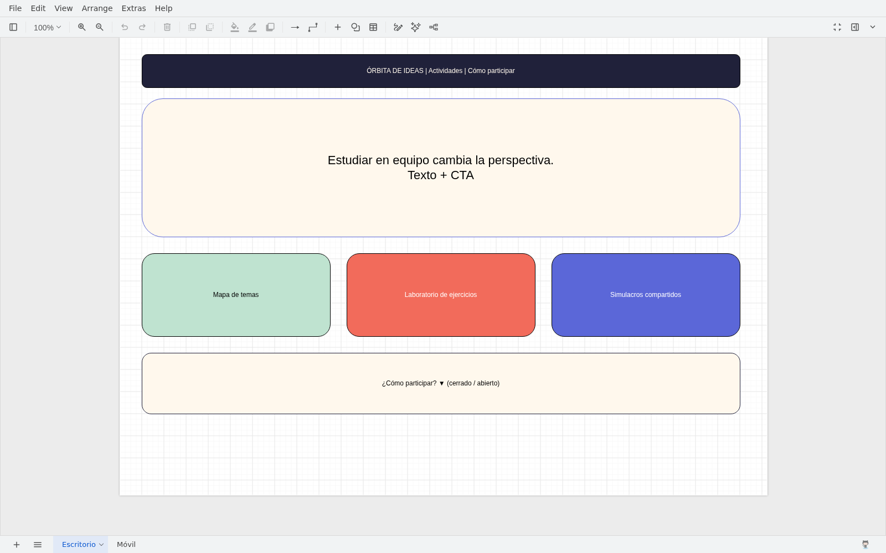
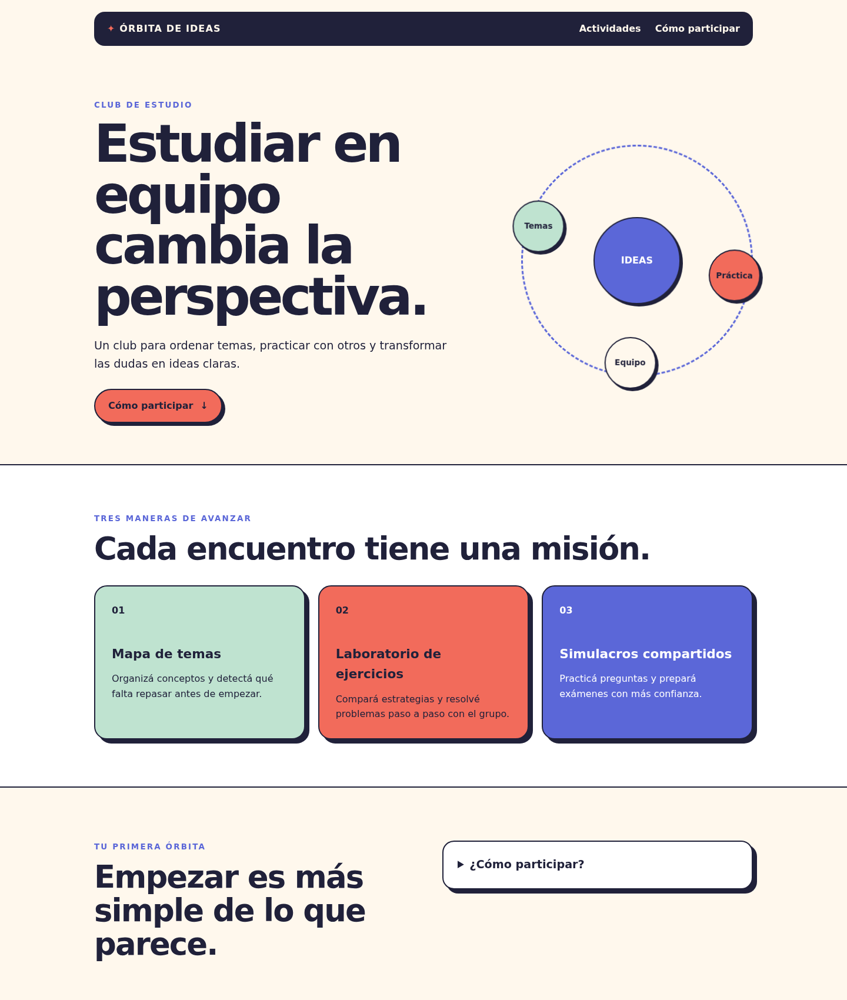
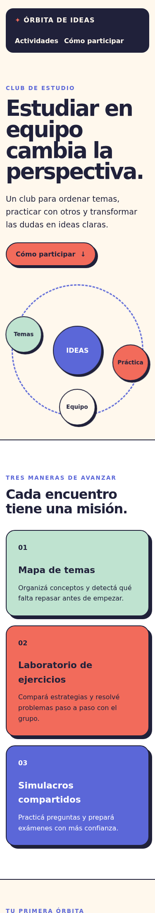

# Landing page — Órbita de Ideas

Landing educativa responsive para estudiantes secundarios. Presenta el club, sus actividades y una guía desplegable para comenzar, sin JavaScript ni dependencias externas.

## Datos generales

- Estudiante: Hodaia Yemal
- Tecnologías: HTML y CSS
- Sketch local: [`evidencias/sketch-landing.png`](evidencias/sketch-landing.png)
- Documentación completa: [`documentacion.md`](documentacion.md)

## Planeamiento

El sketch se creó antes del código y contiene vistas de escritorio y móvil, además de los estados cerrado y abierto del desplegable. La interfaz usa fondo crema, texto azul tinta y acentos violeta, coral y menta.



## Prompt utilizado

```text
Creá una landing responsive en español para “Órbita de Ideas”, sin JavaScript ni dependencias externas. Entregá index.html y css/style.css. Incluí encabezado con navegación interna, hero con el título “Estudiar en equipo cambia la perspectiva.”, descripción y CTA; tres actividades llamadas “Mapa de temas”, “Laboratorio de ejercicios” y “Simulacros compartidos”; una sección “Cómo participar” implementada con details/summary; y pie. Usá los IDs inicio, contenido, actividades y participar. Paleta: #FFF8ED, #20213A, #5B67D8, #F26B5B y #BFE3D0. Usá HTML semántico, enlace para saltar al contenido, foco visible, diseño sin desbordamiento a 320 px y prefers-reduced-motion. No agregues formularios, horarios ni scripts.
```

## Pruebas

- Navegación interna y desplegable con ratón y teclado.
- Foco visible y enlace para saltar al contenido.
- Ausencia de JavaScript.
- Revisión a 320, 375, 768 y 1280 px.
- `node --test tests/structure.test.js`

## Evidencias





## Ejecución

Abrir `index.html` en un navegador. No requiere instalación.
