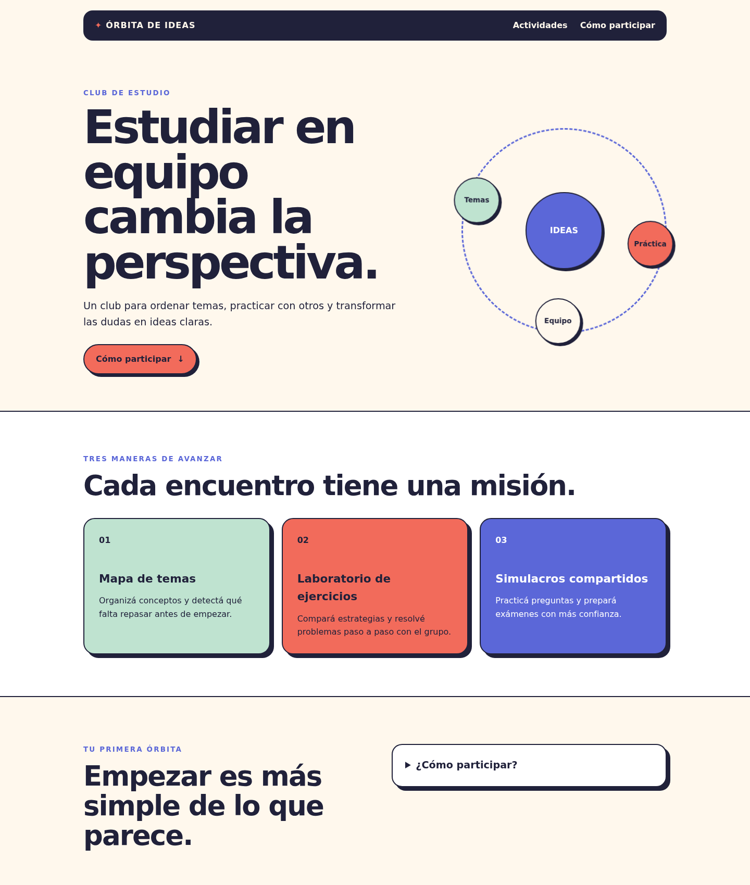
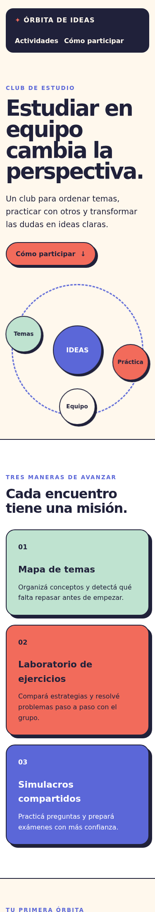

# Landing page — Órbita de Ideas

## Datos generales

- Estudiante: Hodaia Yemal
- Tecnologías: HTML y CSS
- Repositorio: https://github.com/2023hodaiayemal-netizen/landing-page
- Documentación y evidencias: locales, sin Notion ni Moqups

## Sketch y planeamiento

El sketch se creó antes del código y está disponible en `evidencias/sketch-landing.drawio` y `evidencias/sketch-landing.png`. Contiene vistas de escritorio y móvil, además de los estados cerrado y abierto del desplegable.

Público: estudiantes secundarios que preparan exámenes en grupo. Objetivo: presentar el club y explicar cómo participar. La página usa fondo crema, texto azul tinta y acentos violeta, coral y menta.

## Prompt inicial

```text
Creá una landing responsive en español para “Órbita de Ideas”, sin JavaScript ni dependencias externas. Entregá index.html y css/style.css. Incluí encabezado con navegación interna, hero con el título “Estudiar en equipo cambia la perspectiva.”, descripción y CTA; tres actividades llamadas “Mapa de temas”, “Laboratorio de ejercicios” y “Simulacros compartidos”; una sección “Cómo participar” implementada con details/summary; y pie. Usá los IDs inicio, contenido, actividades y participar. Paleta: #FFF8ED, #20213A, #5B67D8, #F26B5B y #BFE3D0. Usá HTML semántico, enlace para saltar al contenido, foco visible, diseño sin desbordamiento a 320 px y prefers-reduced-motion. No agregues formularios, horarios ni scripts.
```

## Pruebas y versiones

| Versión | Cambio | Motivo |
| --- | --- | --- |
| v1 | Estructura semántica, hero, tarjetas, desplegable y estilos adaptables. | Implementación inicial basada en el sketch. |
| v2 | Capturas más altas de escritorio y móvil. | Mostrar la composición completa en la evidencia. |

Pruebas realizadas el 24/11/2026:

- Navegación interna a Actividades y Cómo participar.
- Desplegable nativo abierto con clic, Enter y Espacio.
- Foco visible y enlace “Saltar al contenido”.
- Ausencia de JavaScript.
- Revisión a 320, 375, 768 y 1280 px sin desbordamiento horizontal.
- Prueba estructural automatizada: `node --test tests/structure.test.js`.

## Evidencias





## Estado

- [x] Sketch editable y PNG
- [x] Prompt registrado antes del código
- [x] Landing sin JavaScript
- [x] Interacción accesible
- [x] Pruebas y capturas
